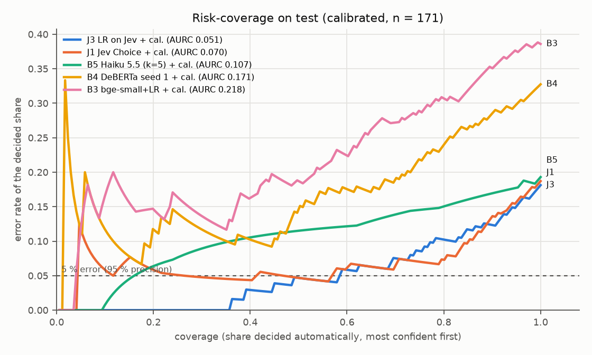
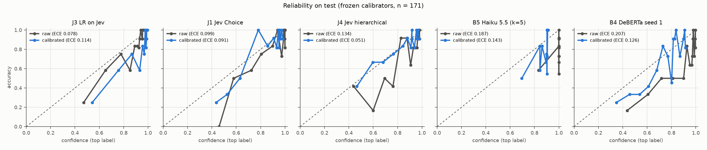

# Phase 1 report: requirement-type classification (PROMISE, locked test)

> **Errata (2026-11-11, after an independent audit).** Several explanations and sentences of
> the first version of this report were wrong or overstated; they are corrected in place and
> marked (E1)–(E8), with the original wording in the "Errata" section at the end. **The
> verdict does not change.** The audit itself is in `AUDIT.md`; its support analyses are
> regenerated by `uv run reqbench audit`.

**Question.** Does Jev (`jev-1.14.0`) classify requirement types well enough, cheaply enough
and reliably enough to be used instead of simpler or cheaper alternatives? The rule for the
answer was preregistered before any model was run (`docs/PREREGISTRATION.md`); everything was
then frozen (`FREEZE.md`, freeze `1ff9e151…`) and the locked test was evaluated **once** on
2026-11-11 (`EVAL_LOG.jsonl`: started 20:06 UTC, completed 20:19 UTC, commit `f9db031`).

**Short answer: inconclusive under the preregistered rule.** On the test, the best Jev variant
(J3, a logistic regression on Jev's outputs) is as accurate as the best preregistered
alternative, Claude Haiku 5.5 with 5 samples, and much better at ranking its own errors; it
beats every local model by a wide margin and is cheaper and 5× faster than Haiku with 5
samples. It is **not** shown to be as accurate as Haiku with a single call (B5x, exploratory),
which is cheaper still (E2). Formally it fails two preregistered guardrails of criterion 3:
its calibrated ECE (0.114 > 0.05), caused mainly by a calibration design flaw rather than by
new projects (E1), and the adversarial flip rate (5 % vs 1.7 %), measured on J1 as a proxy and
not statistically different (E3). Criterion 2(c) (the fresh set) is still pending, but it
cannot turn this into a GO, because criterion 3 fails independently of it.

## What was compared

171 requirements from 6 whole PROMISE projects (2, 4, 7, 9, 13, 15) never used for
development; 6 leaf classes (functional, performance, security, usability,
operational_constraint, other). Systems: majority (B0), keyword rules (B1), TF-IDF + LR (B2),
bge-small embeddings + LR (B3), fine-tuned DeBERTa-v3-small with 5 seeds (B4), Claude Haiku 5.5
zero-shot with k = 5 samples (B5; B5x = its first sample alone, declared exploratory before the
test), Claude Opus 5.5 as a quality ceiling (B6, not a candidate); Jev: flat Choice (J1),
average of 3 option orders (J2), LR on all Jev outputs (J3) and hierarchical (J4). Every
probabilistic system also has a calibrated variant (`+ cal.`) and a review threshold, both
fitted on dev only. Jev and the LLMs saw the same definitions and examples; neither prompts
nor questions were iterated (version 1 of 15 for both).

## Decision (preregistered rule, applied by `reqbench.eval.heldout.decide`)

- **Best Jev** = J3 (macro-F1 0.796); **B\*** = B5 Haiku (0.781; B4's seed mean is 0.647).

| Criterion | Result | Met? |
|---|---|---|
| 1. Non-inferiority: lower CI bound of J3 − B5 > −0.03 | +0.015 [−0.026, +0.054] | **yes** |
| 2(a). ≥ 0.03 better (CI > 0) than every system costing no more (B0–B4, every seed) | +0.093 to +0.702, all CIs > 0 (unadjusted; vs B4 seed 4 Holm p 0.159) | **yes** |
| 2(b). Lower AURC than B\* (CI excludes 0) | 0.052 vs 0.179; Δ −0.127 [−0.170, −0.084] | **yes** |
| 2(c). ≥ 0.03 better than B\* on the fresh set | not evaluated yet | pending |
| 3. ECE of J3 + calibrator ≤ 0.05 | 0.114 (raw J3: 0.078); see E1 and E4 | **no** |
| 3. Run-to-run flip rate ≤ 3 % | 2.0 % (measured on J1, E3) | yes |
| 3. Option-order flip rate ≤ 5 % (or J2) | 4.7 % | yes (barely) |
| 3. p95 latency ≤ 1 s | 277 ms (3 calls per requirement) | yes |
| 3. Cost ≤ $1 per 1,000 | $0.27 | yes |
| 3. Adversarial flip rate ≤ B5's | 3/60 vs 1/60, measured on J1 (Fisher p = 0.62, E3) | **no** (formally) |
| NO-GO conditions (below B\* beyond δ; below B2; instability) | none holds | — |

**Verdict: INCONCLUSIVE.** The preregistration says that then "the simpler, cheaper system
wins", without defining *simpler*. ADR 0001 applied the tie-break in favour of J3; it was
superseded by **ADR 0002, which carries forward B5x (Haiku, one call)**, following the
literal tie-break, because ADR 0001 overlooked B5x (E2). The verdict itself stays
"inconclusive" under any reasonable reading of the rule.

Caveats on the decision itself:
- **"Best Jev" was picked on the test among four variants**, as preregistered; that favours Jev
  slightly (J3 was also the best on dev, 0.836). Only J3 meets non-inferiority: J2 −0.034,
  J1 −0.057 (J1 − B5 = −0.008 [−0.057, +0.042]), J4 fails. J3 and B5 differ in correctness on
  only 9 of 171 requirements.
- The operational reading of the rule (deviation 3) was written after seeing dev, and several
  of its choices favour Jev: the maximum over four variants, B5x outside B\*, criterion 2(a)
  only against local systems and with unadjusted intervals.
- J4 *with its calibrator* scored 0.820 on the test, the highest Jev number: vector scaling
  re-weights the classes and changes some predictions. It is a calibrated variant, not one of
  the four preregistered systems, so it does not enter the rule; it is a lead, not a result.
- With 171 requirements the intervals are wide. To separate J3 from B5 at their observed gap
  (+0.015) with 80 % power would take about 2,500 test requirements; to show non-inferiority
  for J1 at its gap, about 1,700–1,800 (E5).

## Main results (test, n = 171)

| System | Macro-F1 [95 % CI] | Level-1 F1 | Accuracy | AURC | Cov. @ 95 % (oracle) | Frozen threshold on test: coverage (precision) | $ / 1,000 | p95 latency |
|---|---|---|---|---|---|---|---|---|
| B1 keywords | 0.621 [0.530, 0.697] | 0.696 | 0.649 | — | — | — | 0 | < 1 ms |
| B2 TF-IDF + LR | 0.585 [0.484, 0.666] | 0.768 | 0.637 | 0.199 | 0.047 | 0.082 (0.929) | ≈ 0 | 0.2 ms |
| B3 bge-small + LR | 0.637 [0.545, 0.714] | 0.759 | 0.690 | 0.223 | 0.000 | 0 | ≈ 0 | 7 ms |
| B4 DeBERTa, 5 seeds | 0.647 ± 0.044 (0.584–0.703) | 0.807–0.824 | 0.655–0.719 | 0.146–0.180 | 0.05–0.15 | 0 | ≈ 0 | 19 ms |
| **J1** Jev Choice | 0.774 [0.695, 0.838] | 0.872 | 0.795 | 0.070 | 0.503 | 0.655 (0.938) | 0.09 | 256 ms |
| **J2** 3-order average | 0.795 [0.722, 0.857] | 0.883 | 0.813 | 0.069 | 0.474 | 0.649 (0.937) | 0.27 | 277 ms |
| **J3** LR on Jev | **0.796** [0.718, 0.858] | 0.871 | 0.819 | **0.052** | **0.567** | 0.690 (0.932)\* | 0.27 | 277 ms |
| **J4** hierarchical | 0.716 [0.629, 0.786] | 0.776 | 0.743 | 0.106 | 0.374 | 0.561 (0.927) | 0.09 | 256 ms |
| B5 Haiku 5.5, k = 5 | 0.781 [0.705, 0.845] | 0.871 | 0.801 | 0.179 | 0.000 | 0 (no threshold) | 0.64 (0.32 batch) | 1.3 s |
| B5x Haiku, 1 call (exploratory) | 0.788 [0.713, 0.851] | 0.866 | 0.807 | — | — | — | 0.13 (0.064 batch) | 1.2 s |
| B6 Opus 5.5 (ceiling) | **0.857** [0.792, 0.910] | 0.895 | 0.865 | — | — | — | 5.12 (2.56 batch) | 2.5 s |

\* J3's threshold was fitted on a different model from the one evaluated (E1).

Coverage at 95 % (oracle) is what the best threshold *chosen on the test* would give; the
frozen-threshold column is what the thresholds fixed on dev actually gave. Full tables
(every variant, per-class F1, all paired differences with Holm and McNemar p-values):
`TEST_TABLES.md`.

- **Jev against the local models.** J2 and J3 beat every local model by 0.09–0.21 macro-F1
  (every CI > 0, unadjusted); J1 by 0.07–0.19 (its CI against the best DeBERTa seed touches
  0); J4 only beats B0–B2 clearly. The fine-tuned DeBERTa is unstable across seeds
  (0.58–0.70) and no better than the keyword rules on this test.
- **Jev against Haiku.** Same accuracy (J1 −0.008, J2 +0.014, J3 +0.015 against B5; J3 −
  B5x = +0.008 [−0.032, +0.045], post hoc; every CI includes 0). The difference is in
  confidence: with vote frequency over k = 5 samples, Haiku's samples agree on 95 % of
  requirements and those unanimous answers are wrong often enough that no threshold reaches
  95 % precision; Jev's probabilities rank its errors last (AURC 0.05–0.07 vs 0.18). Other
  ways of getting a confidence from Haiku (e.g. asking for one, or token probabilities where
  available) were not tried (E6).
- **Opus scored highest** (0.857). Against J3 the gap is −0.061 [−0.120, −0.009] unadjusted,
  but Holm p = 0.12 and McNemar p = 0.077, so it is not established after correction (E6). It
  costs 10–60× Jev per requirement (batch vs standard, J2/J3 vs J1) and has 10× its latency;
  the task probably has headroom.
- **Everything dropped from dev to test** (J1 0.830 → 0.774, J3 0.836 → 0.796, B5 0.858 →
  0.781, B4 0.687 → 0.647). The test projects differ (two of them have no functional
  requirements). The ranking held, except that J3 overtook J1 and B5 lost its dev edge over J1.
- **J4 (hierarchical) is the weakest Jev variant**: its level-1 Noul (`is_functional`) is the
  bottleneck (level-1 F1 0.776 vs 0.872 for J1).

## Calibration and human-review thresholds

Calibrators were chosen by log loss in nested, project-grouped CV on dev (`FREEZE.md`).
Identity never won the final selection, mostly because Jev's two-decimal probabilities contain
exact zeros and B5's are multiples of 0.2 (for B3 it won 4 of the 5 outer folds; E8).

| System | ECE dev raw → calibrated (nested CV) | ECE test raw → calibrated |
|---|---|---|
| J1 (vector scaling) | 0.078 → 0.044 | 0.099 → 0.091 |
| J2 (vector scaling) | 0.066 → 0.051 | 0.087 → 0.094 |
| J3 (temperature, T = 0.72) | 0.109 → 0.051 | 0.078 → **0.114** |
| J4 (Platt + vector, per question) | 0.067 → 0.035 | 0.134 → **0.051** |
| B5 (vector scaling) | 0.112 → 0.065 | 0.187 → 0.143 |
| B4 seed 1 (temperature) | 0.145 → 0.062 | 0.207 → 0.126 |

- **J3's calibration failed because of a design flaw, not because of new projects (E1).**
  The out-of-fold predictions used to fit J3's temperature and threshold came from per-fold
  models with C = 0.1–1; the final model, retrained on all of dev, chose C = 30 and is already
  sharper and better calibrated. T = 0.72 then sharpened it further. On dev alone, with C = 30
  out of fold, the raw ECE is 0.052 and becomes 0.077 with T = 0.72, and the frozen threshold
  decides 75 % at precision 0.92 (instead of the 33 % at 0.95 recorded at the freeze). On the
  test: mean calibrated confidence 0.924 against accuracy 0.819. The same flaw affects B2–B4
  (hyperparameters or epochs differ between the fold models and the final ones); it was not
  quantified.
- **The ECE threshold is at the noise floor at n = 171 (E4).** A perfectly calibrated system
  with J3's raw test confidences would have a mean ECE of 0.070 (15 equal-mass bins) and fall
  below 0.05 only about 6 % of the time; J3's raw ECE (0.078) is indistinguishable from perfect
  calibration (p = 0.26, post hoc). The calibrated 0.114 is real miscalibration, from E1.
  ECE also depends slightly on row order when confidences tie (J1 on dev: 0.078–0.081).
- **Review thresholds (E6).** At the frozen thresholds Jev decided 56–69 % of the test
  automatically with observed precision 0.93–0.94 (J3: 110 of 118); B5 and B4 decided none.
  These precisions are compatible with 0.95 at this sample size, and J3's is contaminated by
  E1, so the test neither confirms nor refutes the 95 % target.

## Robustness

- **Run-to-run** (5 samples): Jev J1 changes label in 2.0 % of repeats (dev 0.7 %); Haiku
  2.0 %. **Option order** (3 rotations): Jev 4.7 % of rotation pairs (dev 2.1 %), close to the
  5 % limit; Haiku 6.8 %. No first-position bias in either. J2 and J3 average the three orders.
- **Prompt injection (E3)** (60 variants of 20 dev requirements, 3 templates): label flips
  J1 3/60, J4 2/60, B5 (k = 5 vote) 1/60, B5x (one sample) 0/60. None of the differences is
  significant (Fisher J1 vs B5 p = 0.62, J1 vs B5x p = 0.24); J3 was not measured (criterion 3
  used J1 as its proxy). Jev resisted "ignore previous instructions" and fake label prefixes
  (0/20 each) and followed a fake `SYSTEM NOTE` in 3 of 20. A greater susceptibility of Jev is
  **not demonstrated**; Jev's documentation lists sensitivity to adversarial content, and the
  planned service puts a rule-based injection detector and the `addresses_ai` Noul in front.

## Cost and latency (measured on the test calls)

Jev: 2,138 input tokens per call, $0.090 per 1,000 requirements for one call (J1, J4) and
$0.27 for three (J2, J3); p50 169 ms and p95 256 ms in series, p95 262 ms at concurrency 8.
Haiku: one call $0.13 per 1,000 ($0.064 batch), p50 953 ms and p95 1.16 s per call; k = 5
$0.64 ($0.32 batch), p95 1.3 s per requirement with the 5 calls in parallel. Opus: 12 output
tokens on average (it did not think at effort low), $5.12 per 1,000 ($2.56 batch), p95 2.5 s.
Local models on CPU, batch 1: p95 0.2 ms (B2), 7 ms (B3), 19 ms (B4). No invalid answer from
any API model. Test session cost $0.82; project total so far $1.32 of the $10 budget. Prices
of 2026-10-10.

## Other preregistered metrics (test)

Log loss and Brier with 95 % bootstrap CIs; top-label and class-wise ECE (15 equal-mass bins).
Jev's raw log loss is inflated by exact zeros in its two-decimal probabilities; B5's by
unanimous wrong answers (probability 0 for the truth).

| System | Log loss [95 % CI] | Brier | ECE | Class-wise ECE (F / PE / SE / US / OC / other) |
|---|---|---|---|---|
| B2 TF-IDF + LR | 1.052 [0.920, 1.188] | 0.507 | 0.111 | 0.082 / 0.065 / 0.056 / 0.077 / 0.063 / 0.056 |
| B3 bge-small + LR | 1.027 [0.909, 1.153] | 0.494 | 0.175 | 0.102 / 0.076 / 0.068 / 0.092 / 0.096 / 0.074 |
| B4 seeds 1–5 | 1.10–1.41 | 0.473–0.571 | 0.174–0.263 | functional 0.110–0.149, others 0.026–0.121 |
| J1 | 1.976 [0.974, 3.145] | 0.281 | 0.099 | 0.062 / 0.018 / 0.034 / 0.047 / 0.077 / 0.026 |
| J1 + cal. | 0.656 [0.444, 0.900] | 0.256 | 0.091 | 0.064 / 0.021 / 0.033 / 0.049 / 0.069 / 0.017 |
| J2 | 1.809 [0.882, 2.905] | 0.279 | 0.087 | 0.053 / 0.019 / 0.027 / 0.046 / 0.075 / 0.018 |
| J3 | 0.698 [0.473, 0.949] | 0.274 | 0.078 | 0.071 / 0.025 / 0.030 / 0.044 / 0.062 / 0.029 |
| J3 + cal. | 0.795 [0.518, 1.104] | 0.288 | 0.114 | 0.090 / 0.024 / 0.033 / 0.032 / 0.069 / 0.025 |
| J4 | 1.406 [0.709, 2.277] | 0.354 | 0.134 | 0.156 / 0.029 / 0.019 / 0.059 / 0.057 / 0.030 |
| J4 + cal. | 0.679 [0.459, 0.939] | 0.261 | 0.051 | 0.081 / 0.025 / 0.030 / 0.037 / 0.055 / 0.034 |
| B5 Haiku k = 5 | 6.484 [4.473, 8.519] | 0.383 | 0.187 | 0.122 / 0.019 / 0.060 / 0.050 / 0.097 / 0.043 |
| B5 + cal. | 0.904 [0.652, 1.177] | 0.341 | 0.143 | 0.124 / 0.034 / 0.060 / 0.066 / 0.066 / 0.044 |

Confusion matrices (rows = gold, columns = predicted; order F, PE, SE, US, OC, other; gold
counts 67, 20, 19, 28, 24, 13):

| Gold \ predicted | J3 | B5 (k = 5) | B5x (1 call) | B6 Opus |
|---|---|---|---|---|
| functional | 56 1 5 3 2 0 | 57 0 5 3 2 0 | 57 0 5 3 2 0 | 57 0 7 1 2 0 |
| performance | 1 17 0 0 2 0 | 1 17 0 0 2 0 | 2 17 0 0 1 0 | 3 16 0 0 1 0 |
| security | 3 0 16 0 0 0 | 4 0 14 0 1 0 | 4 0 14 0 1 0 | 0 0 19 0 0 0 |
| usability | 0 0 0 25 2 1 | 0 0 0 22 5 1 | 0 0 0 23 4 1 | 0 0 0 27 1 0 |
| operational_constraint | 3 0 1 0 19 1 | 3 0 0 0 19 2 | 3 0 0 0 19 2 | 1 0 2 0 19 2 |
| other | 3 0 0 0 3 7 | 3 0 0 0 2 8 | 3 0 0 0 2 8 | 3 0 0 0 0 10 |

The four systems make almost the same mistakes: functional ↔ security, and "other" read as
functional. Every system's matrix is in `runs/phase1/test/results.json` (`confusion`).

## Where the decision stands

ADR 0001 chose J3 as "the cheapest of the non-inferior options"; that does not hold once B5x
is considered (E2). J3 vs B5x: same accuracy (+0.008 [−0.032, +0.045], post hoc), B5x about
2–4× cheaper and simpler (one prompt, no trained component), J3 about 4× faster and the only
one of the two with a usable confidence for automatic decisions (B5x gives a single label).
**ADR 0002 (2026-11-11) carries forward B5x**, following the literal tie-break; J3's selective
prediction and lower latency are given up (`docs/decisions/0002-phase1-type-decision-b5x.md`).

## Limitations

- 171 test requirements from 6 projects: wide intervals. The project-level bootstrap
  (J3 − B5 = +0.015 [−0.011, +0.041]) resamples only 6 projects and is not a reliable
  interval (E6).
- PROMISE is public since 2007; Jev, Haiku and Opus may all have seen it. The fresh set
  (2025–2026 requirements) is the check, still pending: annotation done (A all 170; B, C, D 30
  each), human agreement low (pooled κ 0.31 on leaves), adjudication not done yet. With that
  agreement and about 150 usable sentences it cannot detect a 0.03 difference between systems
  (AUDIT I8).
- The calibration design flaw (E1) also affects the thresholds of B2–B4.
- Public audit trail: the freeze commit was pushed after the test, together with the results
  (AUDIT I5); the local inference cache supports the order of events but is not public yet.
- Not done yet: leave-one-project-out, the external binary set (Dalpiaz), the contamination
  probe (§6.8), a label-noise audit of the test.

## Reproducing

`uv run reqbench reproduce --from-cache` regenerates every dev table, the calibration, the test
results and these figures from the inference cache without any API key; the test is only
re-read from the cache, never re-evaluated. Checked on 2026-11-11: no spend and frozen files
unchanged. It does overwrite `runs/phase1/test/results.json` (E7): the content is identical to
the logged evaluation except the local models' CPU latency, which is measured again on every
run, so the file hash no longer matches `EVAL_LOG.jsonl`. `uv run reqbench audit` regenerates
the audit analyses. `TEST_TABLES.md` and `figures/` are generated; this file is written by hand.

## Errata (2026-11-11)

Original wording of the first version (commit `4c61357`) and what replaced it.

- **E1 (AUDIT C1).** Was: "Calibration did not transfer well to new projects. … J3's
  temperature sharpened its probabilities (T < 1) to fit dev and overshot on the test." Now:
  J3's temperature and threshold were fitted on out-of-fold predictions of models with other
  hyperparameters than the final model; that mismatch, not new projects, explains the
  calibrated ECE of 0.114. The short answer's "its calibrated confidence is off on the test"
  was qualified accordingly.
- **E2 (AUDIT C2).** The first version did not compare J3 with Haiku with one call (B5x) and
  presented J3 as cheaper than Haiku. B5x is as accurate (post hoc) and cheaper; added to the
  short answer, the main table, cost and "Where the decision stands".
- **E3 (AUDIT I1).** Was: "it is more easily swayed by prompt injection than Haiku (5 % of
  adversarial variants flip its label, against 1.7 %)" and "less robust to injection". Now:
  3/60 vs 1/60 (Fisher p = 0.62), measured on J1 as a proxy for J3; not demonstrated.
  Stability is also J1's.
- **E4 (AUDIT I2).** Added: the ECE ≤ 0.05 target is at the noise floor for n = 171; J3's raw
  ECE is compatible with perfect calibration.
- **E5 (AUDIT I6).** Was: "about 1,200 test requirements … about 870". Those were for ~50 %
  power; for 80 %: about 2,500 and 1,700–1,800.
- **E6 (AUDIT I7).** Was: "Opus is clearly better than everything"; "Review thresholds held
  about 93–94 % precision instead of 95 %"; "B5 … cannot support a 'decide automatically when
  confident' design"; the project-level bootstrap reported as an interval without caveat. Now
  qualified as above.
- **E7 (AUDIT minor).** Was: "`results.json` identical to the logged one except the local
  models' CPU latency". Now states that `reproduce` overwrites the logged file and its hash no
  longer matches (fix deferred until after the fresh set).
- **E8 (AUDIT minor).** Was: "Identity never won". Now: never won the final selection; it won
  4 of 5 outer folds for B3. Added the preregistered metrics that were missing (log loss,
  Brier, class-wise ECE, confusion matrices).
